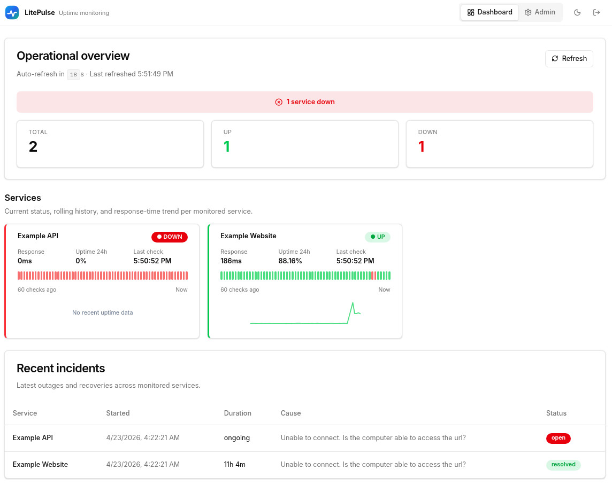
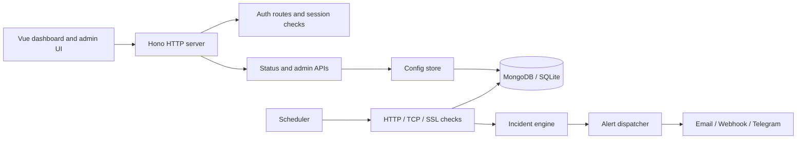

<p align="center">
  
</p>

# LitePulse

[](https://bun.sh)
[](https://vuejs.org)
[](https://hono.dev)
[](https://www.typescriptlang.org/)

LitePulse is a self-hosted uptime monitor for HTTP endpoints, HTTPS certificates, and TCP services. It runs scheduled checks, opens and resolves incidents automatically, sends alerts through multiple channels, and ships with a Vue dashboard plus an admin console for managing monitored services.



## Features

- HTTP and TCP health checks
- SSL certificate expiry tracking for HTTPS services
- Automatic incident open / resolve workflow with configurable thresholds
- Email, webhook, and Telegram alert channels
- Alert cooldowns and maintenance windows
- Dashboard for service health, uptime, incidents, and recent history
- Admin UI for managing services and alert channels in the browser
- MongoDB or SQLite persistence
- Pause / resume support for monitored services
- Input validation and secure default HTTP headers

## Tech stack

- **Runtime:** Bun
- **Backend:** TypeScript + Hono
- **Frontend:** Vue 3 + Vite
- **Validation:** Zod
- **Storage:** MongoDB or SQLite

## Quick start

### Requirements

- Bun
- One of:
  - MongoDB, or
  - SQLite (local file-based storage)

### 1. Install dependencies

```bash
bun install
```

### 2. Create your environment file

```bash
cp .env.example .env
```

### 3. Choose a database

For MongoDB:

```dotenv
DB_ADAPTER=mongodb
MONGODB_URI=mongodb://localhost:27017/lite-pulse
```

For SQLite:

```dotenv
DB_ADAPTER=sqlite
SQLITE_PATH=./uptime.db
```

### 4. Start the app

Production-style run:

```bash
bun run start
```

Development workflow:

```bash
bun run dev
bun run dev:web
```

Default URLs:

- App server: `http://localhost:3000`
- Frontend dev server: `http://localhost:5173`

Once the app is running, open:

- `/` for the status dashboard
- `/admin` for the admin console

## Authentication modes

LitePulse uses **session cookies** for authentication.

- If `ADMIN_USERNAME` and `ADMIN_PASSWORD` are set, the admin console and admin APIs require login.
- If `PUBLIC_STATUS_PAGE=true`, the dashboard is public.
- If `PUBLIC_STATUS_PAGE=false`, the dashboard can be protected with `STATUS_USERNAME` and `STATUS_PASSWORD`.
- Admin sessions can also access the protected status dashboard.

> Current sessions are stored in memory, so restarting the server signs users out.

## Configuration

These are the main environment variables you will usually care about:

| Variable | Default | Purpose |
|---|---|---|
| `PORT` | `3000` | HTTP server port |
| `LOG_LEVEL` | `info` | Server log level |
| `CORS_ORIGIN` | `http://localhost:5173` | Allowed frontend origin for `/api/*` requests |
| `ADMIN_USERNAME` / `ADMIN_PASSWORD` | — | Enables admin authentication |
| `STATUS_USERNAME` / `STATUS_PASSWORD` | — | Enables dashboard authentication when the page is not public |
| `PUBLIC_STATUS_PAGE` | `false` | Makes the dashboard publicly accessible |
| `DATA_RETENTION_DAYS` | `30` | Retention period for historical check results |
| `DB_ADAPTER` | `mongodb` | Storage backend: `mongodb` or `sqlite` |
| `MONGODB_URI` | `mongodb://localhost:27017/lite-pulse` | MongoDB connection string |
| `SQLITE_PATH` | `./uptime.db` | SQLite database file path |
| `MONGO_USE_CAPPED` | `false` | Enables capped collection mode for MongoDB result storage |
| `MONGO_CAPPED_SIZE_MB` | `256` | Size of the capped collection when enabled |
| `SMTP_HOST`, `SMTP_PORT`, `SMTP_USER`, `SMTP_PASS`, `SMTP_FROM` | — | SMTP settings for email alerts |

For the full example, see [`.env.example`](.env.example).

## What LitePulse manages

Services and alert channels are stored in the configured database and can be created or updated from the admin UI.

### Services

- Up to **16** monitored services
- HTTP and TCP checks
- Configurable interval, timeout, failure threshold, and success threshold
- Optional expected HTTP status code and custom headers
- Optional SSL expiry warnings for HTTPS services
- Optional maintenance windows and alert cooldowns

### Alert channels

- Email
- Webhook
- Telegram

Alert delivery is asynchronous and retried with exponential backoff.

## HTTP surface

LitePulse exposes a small HTTP surface:

- `GET /` — dashboard UI
- `GET /admin` — admin UI
- `POST /api/auth/admin/login` — admin login
- `POST /api/auth/status/login` — status-page login
- `POST /api/auth/logout` — logout
- `GET /api/auth/me` — current auth state
- `GET /api/status` — current service status summary
- `GET /api/incidents` — recent incidents
- `GET /api/history/:serviceId` — historical check data for a service
- `GET /api/services` — service list with pause state
- `POST /api/services/:id/pause` and `POST /api/services/:id/resume` — operational controls
- `GET /api/admin/config` — full stored configuration
- `POST/PUT/DELETE /api/admin/services...` — service management
- `POST/PUT/DELETE /api/admin/alerts...` — alert-channel management

## Architecture overview



Key directories:

```text
src/
├── alerts/        Alert routing, cooldowns, and channel integrations
├── config/        Runtime config, schemas, and config store
├── db/            Database adapter abstraction plus MongoDB / SQLite backends
├── http/          Hono server, auth, dashboard serving, and route handlers
├── monitoring/    Scheduler, checkers, incident logic, maintenance, pause state
└── shared/        Shared types, logging, and environment bootstrap

web/
└── src/           Vue application, routes, composables, and UI components

tests/
├── backend/       Backend regression coverage
└── web/           Frontend and UI-focused tests
```

## Commands

| Command | Description |
|---|---|
| `bun run dev` | Run the backend in watch mode |
| `bun run dev:web` | Start the Vite frontend dev server |
| `bun run start` | Build the frontend and start the app |
| `bun run build:web` | Build the frontend bundle |
| `bun run typecheck` | Run TypeScript and Vue type checks |
| `bun run lint` | Run ESLint |
| `bun run test` | Run backend and web tests |
| `bun run build` | Run the full quality gate |

## Development and testing

Useful local checks:

```bash
bun run typecheck
bun run lint
bun run test
bun run build:web
```

Or run the full project validation:

```bash
bun run build
```

## Contributing

Contributions are welcome. For small changes:

1. Fork the repository
2. Create a focused branch
3. Make your change
4. Run the quality checks
5. Open a pull request with a clear summary

If you plan to change behavior or public interfaces, update the documentation in the same pull request.

## License

MIT
